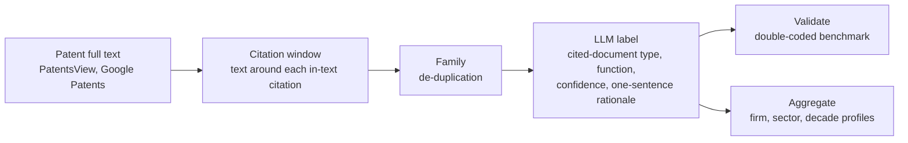
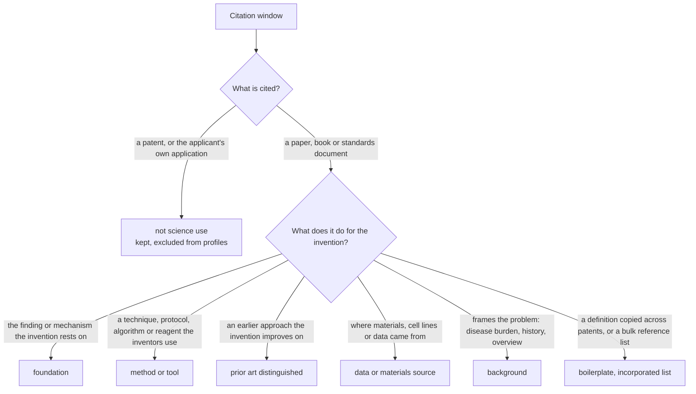

# Science in Invention

**How is science used in invention?**

[Reliance on Science](https://zenodo.org/communities/relianceonscience) (Marx and Fuegi) tells us *which* papers
a patent cites. This project reads the sentence around each in-text citation and labels *what the paper is doing
there*: the mechanism the invention rests on, a method the inventors borrowed, prior art they improve on, or
background. Aggregated to firms, industries and decades, that turns citation counts into science-use profiles.

Pilot stage, October 2026: two samples, 180 patents, 486 citation windows, every one labeled with a one-sentence
rationale. Working repository behind an NBER i3 Open Data Fellows 2027 proposal.

## Pipeline



## The labels



The set adapts the citation-function schemes of information science (Moravcsik and Murugesan 1975; Jurgens et
al. 2018) to patents: it separates the science an invention *rests on* from the techniques it *borrows* (Cohen,
Nelson and Walsh 2002), keeps *prior art distinguished* because a patent must argue novelty, and sets aside
drafting artifacts so they do not count as science use. Rationale, and what has not been tested yet:
[docs/labels.md](docs/labels.md). Prompt: [prompts/label_citation_function.md](prompts/label_citation_function.md).

## What the pilots show


No single use dominates: papers are cited about as often for a method as for the biology or physics the
invention rests on, or for context.


Industries use science for different things. Pharma cites papers for the biology the invention rests on and for
disease context; software/AI and chemicals for methods; semiconductors as prior art to improve on.


Pharma's use of science changed: methods in the 1980s, the target biology (and antibody definitions copied across
patents) in the 2010s. Chemicals stayed centered on prior art distinguished. Electronics patents rarely cite
papers at all.


Firms within a sector differ too. Dow cites procedures where Du Pont and Air Products distinguish prior art;
Pfizer cites target biology where Bristol-Myers cites disease context.


"et al." does not mean a paper: in electronics, most citation windows point to other patents. The document-type
label keeps those out of the profiles instead of counting them as science.

Read these as a demonstration, not as estimates: cells are small (n on every bar), one model (claude-fable-5-1)
labeled every window interactively, and no second coder has labeled anything yet.

## Four windows, four labels

| Sector, decade | What the patent says (abridged) | Label | Why |
| --- | --- | --- | --- |
| pharma, 1980s (Eli Lilly, US4775624A) | "...can be conventionally synthesized by the modified phosphotriester method ... in substantial accordance with the procedure of Itakura et al., 1977, Science 198: 1056" | method or tool | the cited procedure is the one used |
| pharma, 2010s (Bristol-Myers Squibb, US10273236B2) | "...propagated via the feedback activation of Factors V, VIII and XI by catalytic amounts of thrombin (Gailani et al., 2007). ... Therefore, factor XIa plays a key role ... and is thus an attractive target" | foundation | the cited mechanism is why the target is chosen |
| chemicals, 1980s (Dow, US4798081A) | "...while size exclusion chromatography provides insight into long chain branching (Lecacheux et al., 1982, 1984), size exclusion chromatography leaves much to be desired where short chain branching information is required" | prior art distinguished | the cited technique's limitation motivates the invention |
| pharma, 2010s (Pfizer, US10138298B2) | "(v) a dAb portion (Ward et al., (1989) Nature 341:544-546), which consists of a VH domain" | definitional boilerplate | a standard definition copied across antibody patents |

All 486 labeled windows with their rationales: `pilot/citation_windows_labeled.jsonl` and
`pilot/decades/citation_windows_labeled.jsonl`. `examples/demo/report.md` walks through 34 of them.

## Reproduce

```text
pip install -r requirements.txt
bash scripts/rebuild_pilot.sh        # labeled files, profiles, figures, schema checks; no API key needed

python fetch_patents.py --source google --assignee "Genentech" --after-priority 20170101 --output new.jsonl
python common/llm.py --prompt prompts/label_citation_function.md --schema schema.json --input new.jsonl --output new_labeled.jsonl
python aggregate.py new_labeled.jsonl --by assignee
```

`common/llm.py` runs on the Anthropic API or any OpenAI-compatible endpoint (vLLM, Together, DeepInfra), so an
open-weight model can run the production pass. `benchmark/run_benchmark.sh` labels the pilot with a second model
and `common/validate.py agreement` compares two label files (accuracy, Cohen's kappa, per-label precision and recall).

<details>
<summary><b>Data and layout</b></summary>

| Sample | Patents | Firms | Windows | Science-citing, de-duplicated | Files |
| --- | --- | --- | --- | --- | --- |
| Pilot, eight sectors, priority 2017+ | 109 | 68 | 291 | 211 | `pilot/` |
| Decade sample, three sectors, 1980s to 2010s | 71 | 9 | 195 | 139 | `pilot/decades/` |
| Worked example | 4 | 4 | 34 | 32 | `examples/demo/` |

Each labeled row: patent, assignee, dates, window text, document type, function, confidence, verbatim citation
string, rationale, family-duplicate flag. `profiles_*.csv` give shares with window and patent counts;
`summary.md` in each folder holds the tables behind the figures.

```text
schema.json                 JSON schema for one labeled window
prompts/                    the labeling prompt
docs/labels.md              why these labels; what has and has not been tested
docs/firm_linkage.md        joins to PatentsView, DISCERN, KPSS and the 1900-1980 Golden Age firm panel
fetch_patents.py            collection stage (Google Patents samples; PatentsView bulk text)
run_pipeline.py             end-to-end: fetch -> window -> label -> aggregate -> report
aggregate.py                science-use profiles by assignee, sector, year, decade
common/llm.py               schema-constrained labeling, provider-agnostic, cached
common/validate.py          agreement metrics and schema checks
benchmark/                  model comparison: run_benchmark.sh, results.md (empty until run)
examples/demo/              worked example: four patents, every intermediate file, report.md
pilot/, pilot/decades/      raw and labeled windows, labels_*.py (source of truth), profiles, summary.md
scripts/rebuild_pilot.sh    regenerates every derived file and figure, runs the schema checks
scripts/make_figures.py     the five README figures
```

</details>

<details>
<summary><b>Provenance and limits</b></summary>

- **Labels.** All labels were produced by one closed model (claude-fable-5-1) in an interactive session with the
  prompt in `prompts/`; `pilot/labels_pilot.py` and `pilot/decades/labels_decades.py` hold every label with its
  rationale and regenerate the labeled files. No second coder and no second model has labeled anything yet.
- **Sampling.** Pilot patents are the first granted patents per assignee query in Google's ranking that contain
  "et al." (priority 2017+, up to three windows each); the decade sample takes the first two per firm and decade
  with priority and grant in the decade. Google's assignee search is fuzzy; the decade sample filters on the
  printed assignee, the first pilot kept corporate fuzzy matches under the printed name (`pilot/README_pilot_method.md`).
- **Windows.** The regex cue finder accepts noise by design; in the full build the window finder starts from the
  Reliance on Science in-text citations, and a lightweight classifier replaces the regex.
- **Cell sizes.** Sector, decade and firm cells are small (counts printed next to every share); the figures show
  that the measure separates industries and moves over time, not by how much.

</details>

## Roadmap

- [x] Pilot: 109 patents, 291 windows labeled with rationales; sector profiles (Oct 2026)
- [x] Decade sample: nine firms, three sectors, 1980s-2010s; sector, decade and firm profiles (Oct 2026)
- [ ] Double-code the pilots; open-weight model comparison; label-set comparison (`docs/labels.md`)
- [ ] 2,000-window benchmark stratified by sector, citation format and decade; codebook
- [ ] Document-type and function passes over every Reliance on Science in-text citation in US patents, 1976-2024
- [ ] Firm linkage (DISCERN, KPSS, Golden Age panel); industry-year and firm-year science-use profiles
- [ ] v1.0 release (code on GitHub, data on Zenodo and the i3 Index) with codebook, December 2027

Sources: USPTO full text via PatentsView (public domain); Google Patents (samples only); Reliance on Science (Marx
and Fuegi; cite it when using the patent-paper links); OpenAlex (CC0); DISCERN and KPSS under their own licenses.
Code MIT (`LICENSE`), released data CC BY 4.0, citation in `CITATION.cff`.
Contact: Hansen Zhang, Duke University (Fuqua), hansen.zhang@duke.edu.
