# Science in Invention

**How is science used in invention?**

[Reliance on Science](https://zenodo.org/communities/relianceonscience) (Marx and Fuegi) tells us *which* papers
a patent cites. This project reads the sentence around each in-text citation and labels *what the paper is doing
there*: the finding the invention rests on, a method the inventors borrowed, a prior approach they improve on, or
background. Aggregated to firms, industries and decades, that turns citation counts into science-use profiles.

Pilot stage, November 2026: a long-run sample of 8,288 patents in 11 technology classes, 1900s to 2020s, and two
smaller pilots (515 and 420 citation windows), every window labeled with a one-sentence rationale. Working repository
behind an NBER i3 Open Data Fellows 2027 proposal.

## Key findings

- **Methods lead.** In most decades the cited work is most often a method the inventors use: 23% of science-citing
  patents in the 1900s, 44% in the 1940s, 20% in the 1990s and 46% in the 2020s ([Figure 1](#the-long-run-1900s-to-2020s)).
- **Context grows, the basis shrinks.** Context only rises from 13% in the 1900s to 33% in the 2000s; basis of the
  invention falls from 16% in the 1900s to 6% in the 2020s.
- **Firms differ most by what they make.** Google cites science as a method used in 74% of its science-citing patents;
  Pfizer's citations turned from methods (53% in 1950-79) to the biology the invention rests on (23% in 2000-26);
  AT&T, GE, DuPont and IBM mostly mirror their industries ([Figures 7 and 8](#firms-and-fields)).
- **Young fields look different, but not in a life-cycle way.** Fields observed before their takeoff cite science as
  the basis in 16% of patents and as a method in 18%, against 6-11% and 28-35% for old fields in the same decade; the
  contrast is between fields, not within them, and in the 2000s-2020s AI, genetic engineering, quantum computing and
  lithium batteries use science much like century-old fields ([Figures 9 and 10](#firms-and-fields)).

The roles in the figures: **Basis of the invention**, the finding the invention rests on; **Method used**, a technique
the inventors carry out; **Prior approach improved on**; **Context only**, the paper frames the problem;
**Definition only**, the paper defines a term; **Other**, a source of materials or data, a reference-list entry or the
applicant's own earlier patent. Tests and examples: [How it works](#how-it-works).

## The long run, 1900s to 2020s

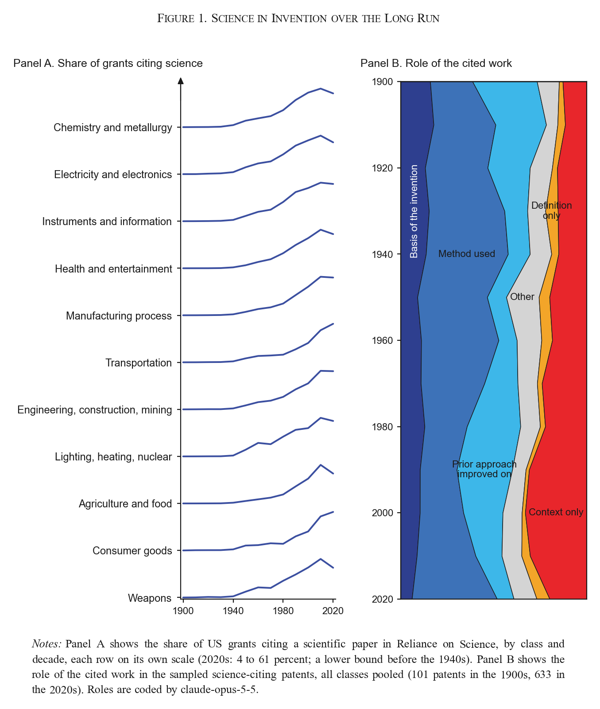

Reliance on Science links a growing share of grants to papers from the 1940s on, most of all in chemistry and
metallurgy (panel A). Among the 6,162 science-citing patents of the long-run sample, methods used lead in most
decades, prior approaches improved on in the 1900s and 1980s, and context only in the 1990s and 2000s (panel B).

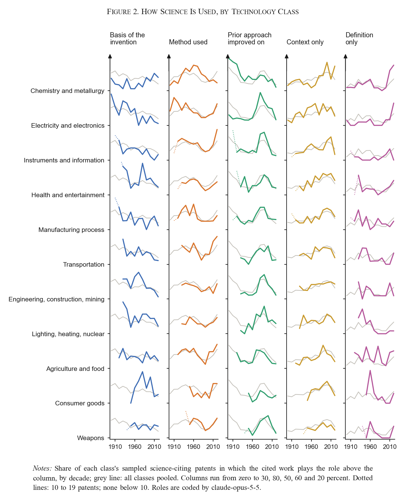

One in-text citation window per patent, about 50 science-citing patents per class and decade; 104 of the 143 cells
reach 50. The cells that do not, mostly before the 1930s, hold every in-text science citation the sampling frame, the
window finder and a full-text read could find; their lines are dotted or missing.

## Firms and fields

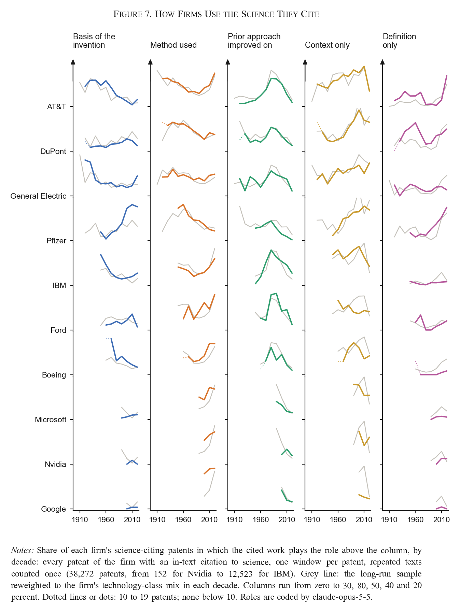

Every patent of eleven firms with an in-text citation to science, one window per patent, 38,272 science-citing
patents after repeated window texts (continuations, boilerplate) are counted once. AT&T, General Electric and DuPont
cite science mainly as a method before 1950 and follow the economy-wide rise of prior approaches improved on in the
1980s and 1990s. Pfizer moves from methods to the target biology the invention rests on. Google's science is almost
all methods used (74%, against 44% for its technology class): machine-learning, vision and systems papers, many of
them its own.

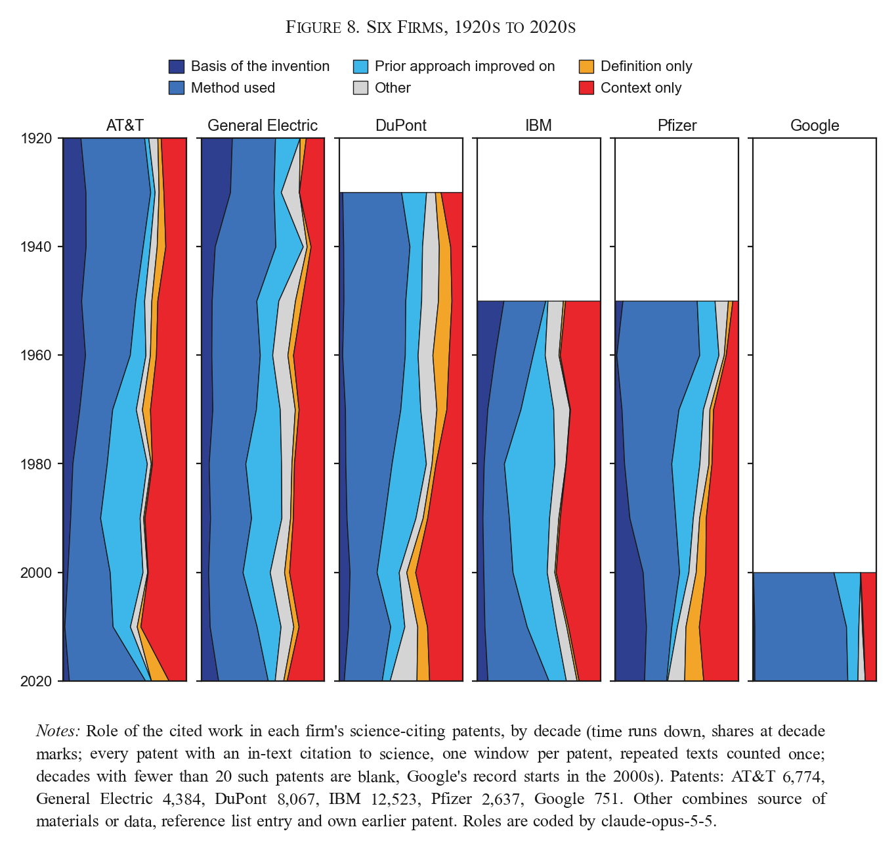

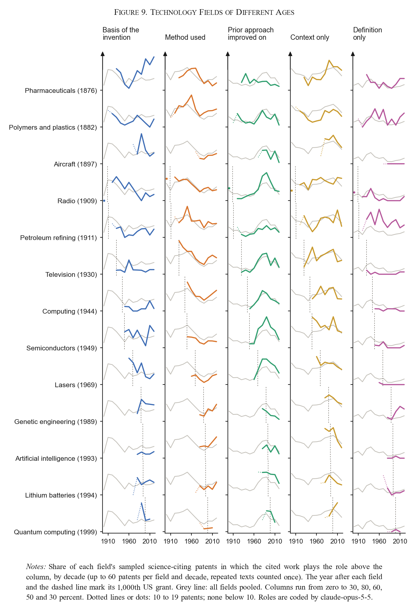

Fourteen fields defined by the first CPC code, up to 60 patents per field and decade, each dated by the year of its
1,000th US grant. Lasers in the 1960s, genetic engineering and AI in the 1980s and quantum computing in the 1990s
cite science before their takeoff more often as the basis of the invention and less often as a method than old fields
do in the same decade; the prior-approach share peaks 40 to 60 years after takeoff and is lowest in fields more than a
century old.

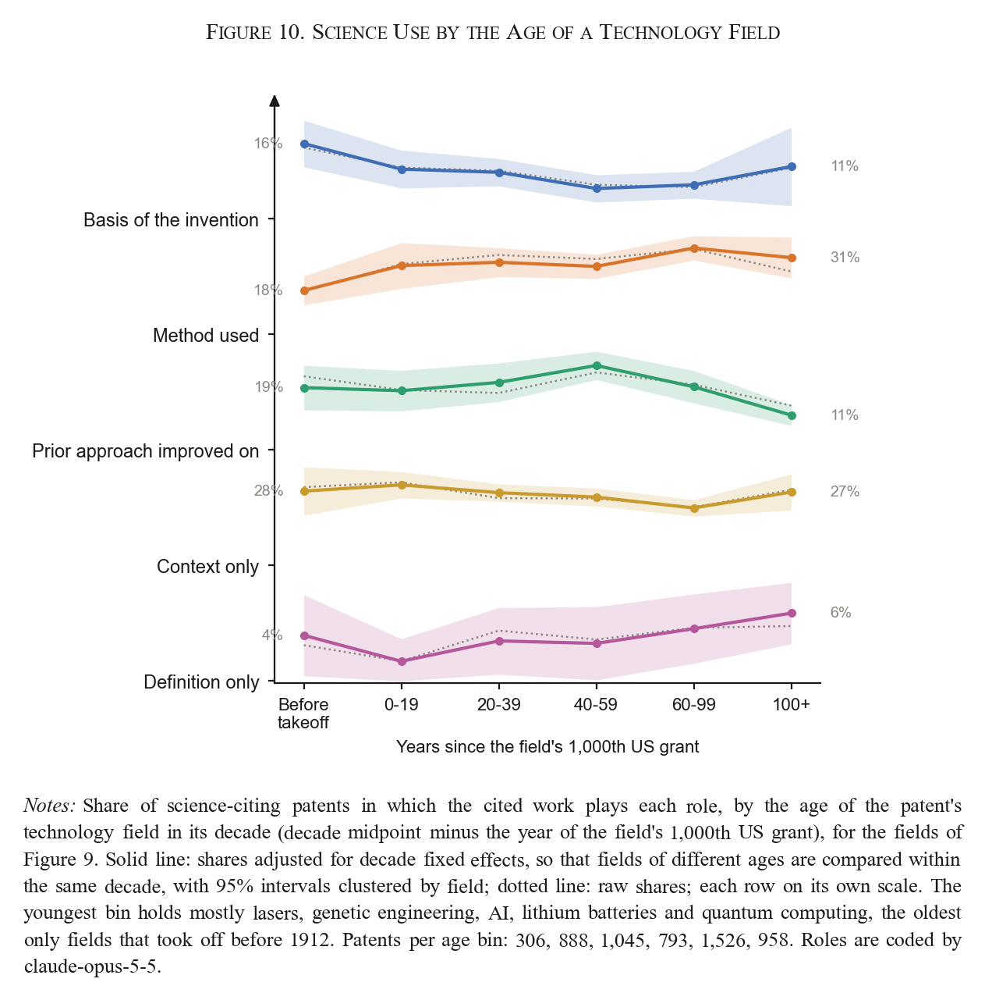

The age profile compares fields of different ages within a decade, not a field with its own past: with field fixed
effects the method and prior-approach gaps vanish, and the basis gap is not significant at other takeoff dates. In
the 2000s to 2020s the four emerging fields and the seven oldest do not differ detectably (basis 10% and 9%, method
26% and 28%, prior approach 18% and 14%); the spread between fields within each group is far larger (AI 37% methods,
quantum computing 10%; pharmaceuticals 26% basis, polymers 3%).

## What the pilots show

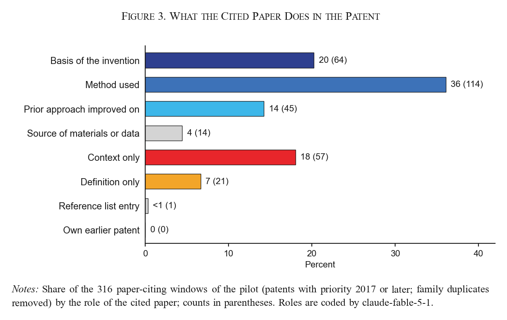

A method is the most common thing a patent takes from a paper (36% of 316 paper-citing windows).

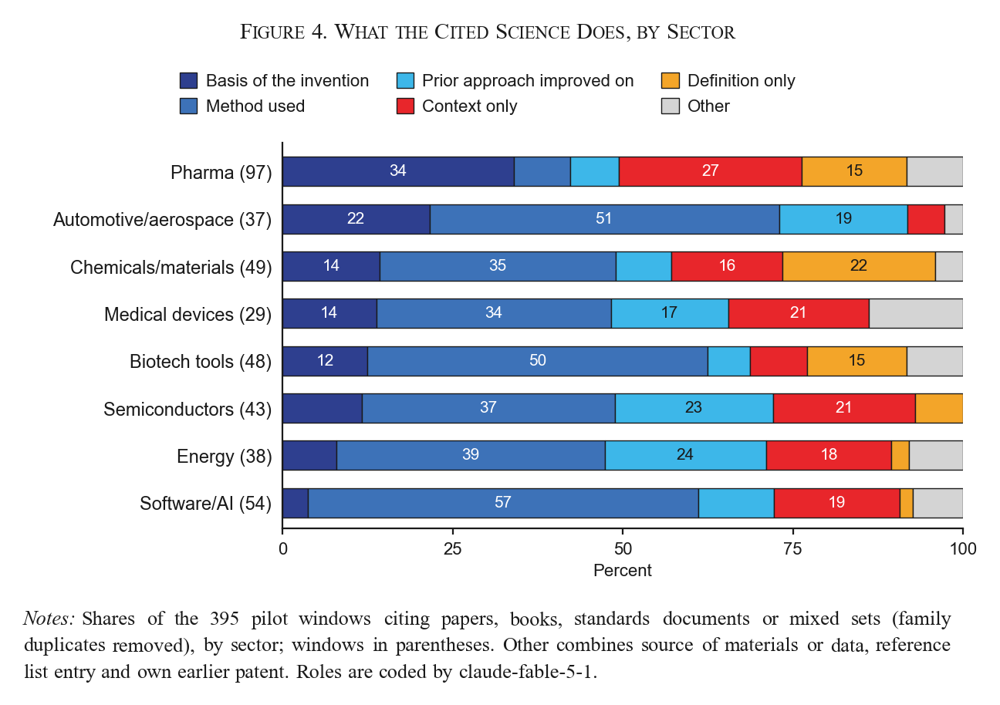

Pharma cites science for the biology the invention rests on and for disease context; software/AI, biotech tools and
automotive firms for methods; semiconductors and energy have the largest shares of prior approaches improved on.

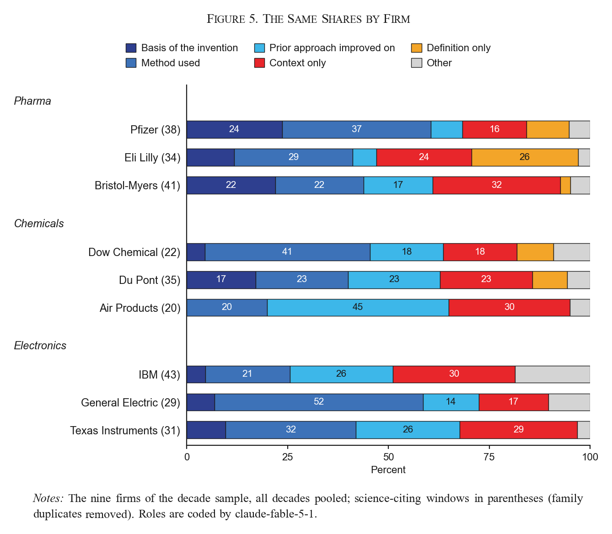

Dow cites procedures where Du Pont and Air Products improve on prior approaches; Pfizer cites target biology where
Bristol-Myers cites disease context; General Electric uses standards and papers as methods where IBM improves on them.


"et al." does not mean a paper: in the decade sample's electronics sector, 27% of the citation windows point to other
patents. The document-type label keeps those out of the profiles.

The pilots are a demonstration, not estimates: cells are small (n in parentheses on every bar), the labels are model
labels, and no human coder has labeled anything yet. The decade sample's shares by decade, superseded by the long-run
sample, are in [data/5_figures/function_by_decade.png](data/5_figures/function_by_decade.png).

## How it works

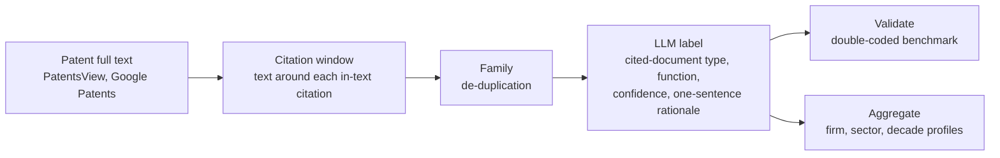

One question per citation: **what does the invention take from the cited paper?**

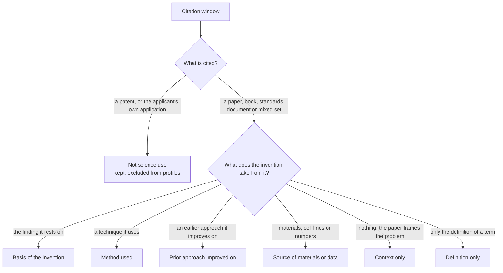

| Name in figures | The test | Example from the data |
| --- | --- | --- |
| Basis of the invention | The invention rests on the paper's finding: a mechanism, structure or clinical result that explains why the invention is designed as it is. Signals: "plays a key role", "is therefore a target", "by utilizing this effect". | "...propagated via the feedback activation of Factors V, VIII and XI by catalytic amounts of thrombin (Gailani et al., 2007). ... factor XIa ... is thus an attractive target" (Bristol-Myers, 2010s) |
| Method used | The inventors carry out a technique, protocol, algorithm or reagent from the paper. Signals: "according to the procedure of", "as described in", "may be implemented as in". | "...synthesized by the modified phosphotriester method ... in substantial accordance with the procedure of Itakura et al., 1977" (Eli Lilly, 1980s) |
| Prior approach improved on | The paper describes an earlier approach the invention improves on, differs from or works around. Signals: "however", "conventional", "suffers from", a drawback stated right after the citation. | "...size exclusion chromatography provides insight into long chain branching (Lecacheux et al., 1982, 1984), [but] leaves much to be desired where short chain branching information is required" (Dow, 1980s) |
| Source of materials or data | A material, cell line, dataset or parameter value in the patent comes from the paper. Signals: "obtained from", "values taken from", a table source. | "Rate constants of elementary reaction rates as determined by Goto et al" (Dow, 2010s) |
| Context only | The paper frames the problem and the invention neither relies on it nor improves on it: disease burden, history of a field, literature overviews, "for more information see". | "...500,000 cases of pneumococcal pneumonia annually in the United States. See Centers for Disease Control and Prevention, MMWR 1997" (Merck, 2017+) |
| Definition only | The paper is cited to define a term, as patents routinely do; the same citation recurs across many patents of a field. Signals: "as used herein", "the term X refers to", a definitions section. | "(v) a dAb portion (Ward et al., (1989) Nature 341:544-546), which consists of a VH domain" (Pfizer, 2010s) |
| Other | An entry in a bulk reference list with no stated role, or the applicant's own earlier patent. | "2. Article: 'Evaluating Pictographic Symbols: An Automotive Application' Paul Green et al, Human Factors, 1978" (IBM, 1980s) |

The first four are substantive uses of science; context is weak use; the rest are drafting artifacts. The set adapts
the citation-function schemes of information science (Moravcsik and Murugesan 1975; Jurgens et al. 2018) to patents,
with the findings-versus-techniques split of Cohen, Nelson and Walsh (2002) at its center. Decision rules and what has
not been tested yet: [docs/labels.md](docs/labels.md); the prompt: [2_label/prompts/label_citation_function.md](2_label/prompts/label_citation_function.md).
The data files keep short machine labels (`foundation`, `method_or_tool`, `prior_art_distinguished`, ...).

## Data and reproduction

| Sample | Patents | Assignees / target firms | Windows | Science-citing, de-duplicated | Files |
| --- | --- | --- | --- | --- | --- |
| Long-run sample, 11 technology classes, 1900s to 2020s | 8,288 | 4,852 | 8,288 | 6,162 | `data/*/longrun/` |
| Firm sample, every science-citing patent of 11 firms, 1900s to 2020s | 52,107 | 11 | 52,107 | 38,272 | `data/*/firms/` |
| Field sample, 14 technology fields, 1900s to 2020s | 5,822 | 2,612 | 5,822 | 5,462 | `data/*/fields/` |
| Pilot, eight sectors, priority 2017+ | 200 | 127 | 515 | 395 | `data/*/pilot/` |
| Decade sample, three sectors, 1900s to 2020s | 196 | 25 | 420 | 351 | `data/*/decades/` |
| Worked example | 4 | 4 | 34 | 32 | `data/examples/demo/` |

Each labeled row holds the patent, assignee, dates, window text, document type, function, confidence, verbatim
citation string and rationale. `data/4_aggregate/<sample>/summary.md` holds the tables behind the figures;
`data/examples/demo/report.md` walks through 34 windows.

```text
pip install -r requirements.txt
bash rebuild.sh        # labeled files, profiles, figures, schema checks; no API key needed

python 1_fetch/fetch_patents.py --source google --assignee "Genentech" --after-priority 20170101 --output new.jsonl
python 2_label/llm.py --prompt 2_label/prompts/label_citation_function.md --schema 2_label/schema.json --input new.jsonl --output new_labeled.jsonl
python 4_aggregate/aggregate.py new_labeled.jsonl --by assignee
```

`2_label/llm.py` runs on the Anthropic API or any OpenAI-compatible endpoint (vLLM, Together, DeepInfra), so an
open-weight model can run the production pass; `3_validate/validate.py agreement` compares two label files.

<details>
<summary><b>Repository layout</b></summary>

```text
1_fetch/fetch_patents.py    collection stage: Google Patents samples, PatentsView bulk text, saved descriptions; the window finder
2_label/                    the labeling prompt (prompts/), schema.json, llm.py (schema-constrained labeling, provider-agnostic,
                            cached) and labels_*.py: the hand labels of the pilot and decade samples (source of truth) and the
                            builders that join model labels to raw windows
3_validate/                 validate.py (agreement metrics, schema checks), subagent_batches.py (blind second coding),
                            run_benchmark.sh (open-weight models on an OpenAI-compatible endpoint)
4_aggregate/aggregate.py    science-use profiles by assignee, sector, year, decade
5_figures/make_figures.py   the README figures
common/paths.py             where the data lives (data/ beside the code, or $SCIENCE_DATA)
docs/                       labels.md (why these labels; what has and has not been tested), firm_linkage.md, pilot_method.md
run_pipeline.py             end-to-end: fetch -> window -> label -> aggregate -> report;  rebuild.sh regenerates everything
data/0_raw/<sample>/        citation windows as found (the only non-regenerable data; firm files gzip-compressed)
data/1_fetch/fields/        US grants per field and year (takeoff dates)
data/2_label/<sample>/      model label files (labels_<sample>.jsonl, source of truth for the model-labeled samples) and
                            the labeled windows
data/3_validate/results.md  second-coder and test-retest agreement
data/4_aggregate/<sample>/  profiles and summary.md;  data/5_figures/  the figures and maturity_margins.csv
data/examples/demo/         worked example: four patents, every intermediate file, report.md
```

</details>

<details>
<summary><b>Provenance and limits</b></summary>

- **Labels.** Pilot and decade sample: first pass by claude-fable-5-1 (`2_label/labels_pilot.py`,
  `2_label/labels_decades.py`), blind second pass by claude-opus-5-5 over all 935 windows (function kappa 0.73
  on the pilot and 0.78 on the decade sample; cited document type 0.91 and 0.93). Long-run sample: claude-opus-5-5
  as blind Claude Code subagents on all 8,288 windows, a blind claude-fable-5-1 pass on 3,017 of them (function kappa
  0.77, cited document type 0.91). Firm and field samples: claude-opus-5-5 blind subagents on all 57,929 windows; a
  blind second claude-opus-5-5 pass over every 20th batch (2,820 windows) gives the same function for 92% (kappa
  0.89) and the same document type for 98% (kappa 0.96), a measure of consistency, not accuracy. Details:
  `data/3_validate/results.md`. No human coder has labeled anything yet; two models agreeing is not a human benchmark.
- **Firm and field samples.** Firms are matched on assignee names (AT&T with Bell Labs and Western Electric, Google
  with DeepMind); every patent with an in-text Reliance on Science citation to a paper, plus pre-1980 patents whose
  text carries a strict citation cue, keeps one window by the rules in `2_label/labels_firms.py`. A window that
  repeats the text of an earlier patent of the same firm is flagged and left out of the figures (14-57% of a firm's
  patents, continuations and templates). Fields are first-CPC-code groups (`local` scripts, listed in the docstring of
  `2_label/labels_fields.py`); takeoff is the year of the field's 1,000th US grant from Google Patents Public
  Data. The grey benchmark in Figure 7 is the long-run sample reweighted to each firm's technology-class mix in the decade,
  because the pooled sample weights the 11 classes equally and single-industry firms differ from it mainly through
  their class. Generic standard citations (IEEE 802.11, IEEE 754,
  the IEEE dictionary) are labeled inconsistently between method and context and need a codebook rule.
- **Long-run sample.** Technology classes follow Kelly, Papanikolaou, Seru and Taddy (2021), assigned from the first
  CPC code. Per class and decade, patents come in hash order from a BigQuery table of every US grant 1900-2026 that
  Reliance on Science links to a paper or, before 1976, whose text matches a citation cue; each keeps one in-text
  citation window. Short cells were filled from further draws and from a full-text read (claude-opus-5-5) of every
  patent in them that Reliance on Science links to a paper with confidence 5 or more. Rules and yields: the
  docstring of `2_label/labels_longrun.py`.
- **Pilot and decade samples.** Pilot: the first two granted patents per assignee query in Google's ranking that
  contain "et al." (priority 2017+, up to three windows each). Decade sample: two patents per firm and decade for nine
  firms in pharma, chemicals and electronics, from Google Patents for the 1980s to 2010s and from the Reliance on
  Science frame on BigQuery otherwise, with period peers where the nine firms have no science-citing patents.
  Details: `docs/pilot_method.md` and the docstring of `2_label/labels_decades.py`.
- **Old OCR text.** Patents granted 1947-1975 print the front page's "References Cited" list inside the OCR text; the
  window finder cuts that block (`cut_references_cited`) so that only running-text citations count.
- **Windows and identifiers.** The regex cue finder accepts noise by design; in the full build the window finder
  starts from the Reliance on Science in-text citations. A window can contain several cited works; the provisional
  `cited_work_string` is not yet linked to Reliance on Science or OpenAlex.
- **Cell sizes.** Counts are printed with every share; the pilot figures show differences in stated citation roles
  within these samples and do not establish population trends.

</details>

## Roadmap

- [x] Pilot: 200 patents, 515 windows labeled with rationales; sector profiles (Oct 2026)
- [x] Decade sample: three sectors, every decade 1900s-2020s (nine firms plus period peers); sector, decade and firm profiles (Oct-Nov 2026)
- [x] Blind second coding of every pilot window by a second model (claude-opus-5-5): `data/3_validate/results.md` (Nov 2026)
- [x] Long-run sample: 11 technology classes x 13 decades, 8,288 patents, labeled by claude-opus-5-5 (Nov 2026)
- [x] Firm sample (every science-citing patent of 11 firms, 52,107) and field-age sample (14 fields, 5,822), labeled
      by claude-opus-5-5 with a test-retest pass (Nov 2026)
- [ ] Double-code the pilots with human coders; open-weight model comparison; label-set comparison (`docs/labels.md`)
- [ ] 2,000-window benchmark stratified by sector, citation format and decade; codebook
- [ ] Document-type and function passes over every in-text citation to science in US patents, 1900-2026: Reliance on
      Science in-text citations where they exist, the window finder on Google Patents text for earlier patents
- [ ] Firm linkage (DISCERN, KPSS, Golden Age panel); industry-year and firm-year science-use profiles
- [ ] v1.0 release (code on GitHub, data on Zenodo and the i3 Index) with codebook, December 2027

Sources: USPTO full text via PatentsView (public domain); Google Patents pages and Google Patents Public Data on BigQuery (samples,
and full text and assignees before 1976); Reliance on Science (Marx and Fuegi; cite it when using the patent-paper links or the
sampling frame); OpenAlex (CC0); DISCERN and KPSS under their own licenses.
Code MIT (`LICENSE`), released data CC BY 4.0, citation in `CITATION.cff`.
Contact: Hansen Zhang, Duke University (Fuqua), hansen.zhang@duke.edu.
