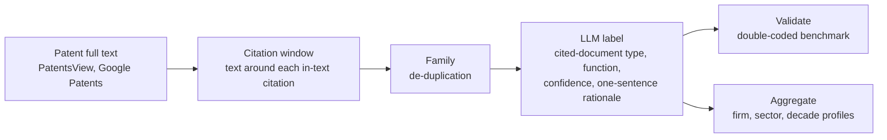
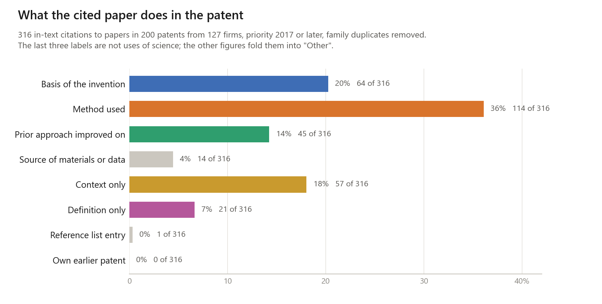
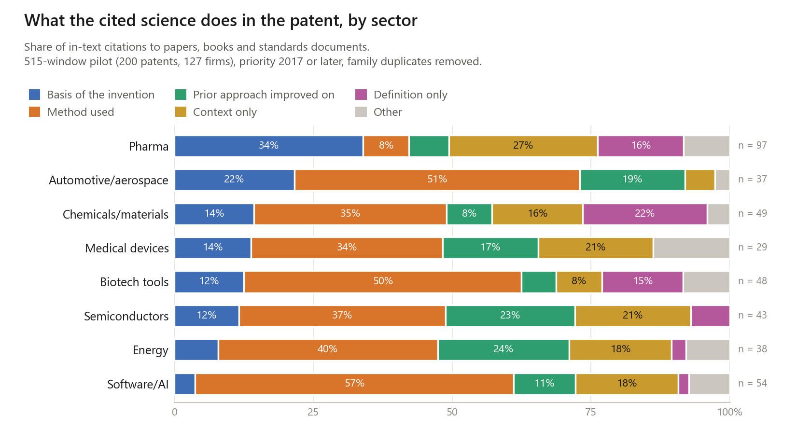
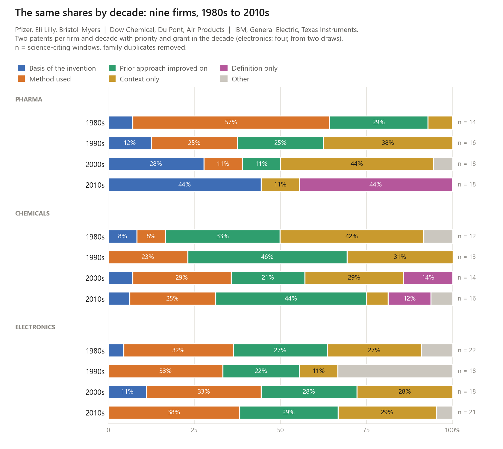
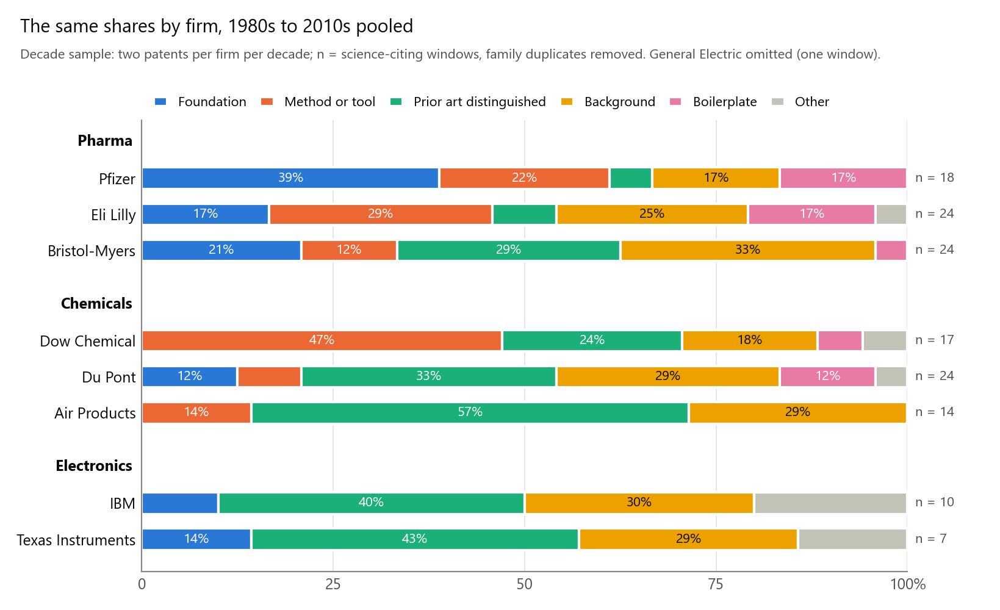
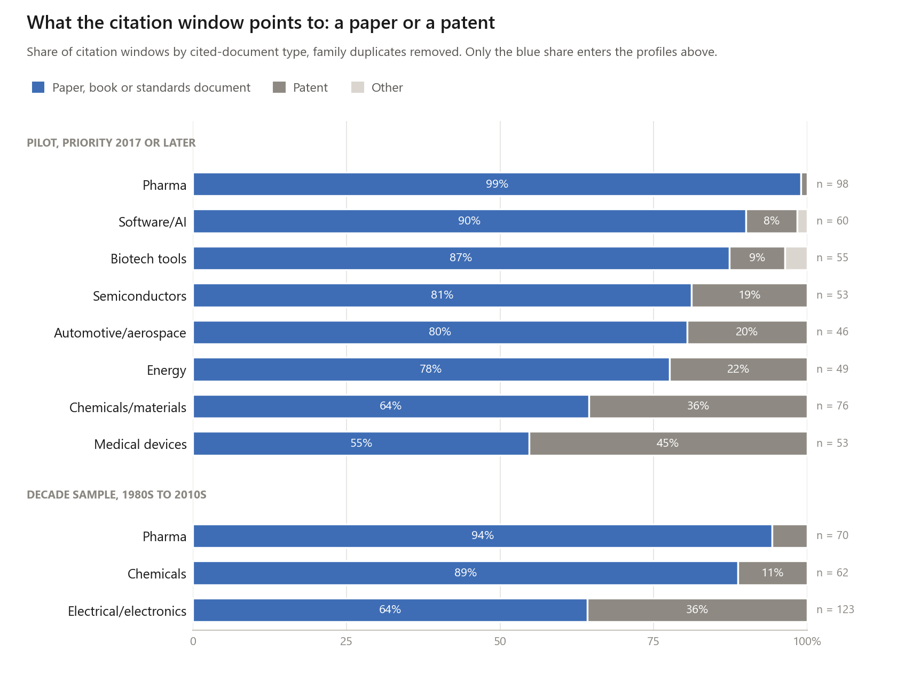

# Science in Invention

**How is science used in invention?**

[Reliance on Science](https://zenodo.org/communities/relianceonscience) (Marx and Fuegi) tells us *which* papers
a patent cites. This project reads the sentence around each in-text citation and labels *what the paper is doing
there*: the mechanism the invention rests on, a method the inventors borrowed, prior art they improve on, or
background. Aggregated to firms, industries and decades, that turns citation counts into science-use profiles.

Pilot stage, October 2026: two samples, 294 patents, 776 citation windows, every one labeled with a one-sentence
rationale. Working repository behind an NBER i3 Open Data Fellows 2027 proposal.

## Pipeline



## The labels

One question per citation: **what does the invention take from the cited paper?**


| Name in figures | The test | Example from the data |
| --- | --- | --- |
| Basis of the invention | The invention rests on the paper's finding: a mechanism, structure or clinical result that explains why the invention is designed as it is. Signals: "plays a key role", "is therefore a target", "by utilizing this effect". | "...propagated via the feedback activation of Factors V, VIII and XI by catalytic amounts of thrombin (Gailani et al., 2007). ... factor XIa ... is thus an attractive target" (Bristol-Myers, 2010s) |
| Method used | The inventors carry out a technique, protocol, algorithm or reagent from the paper. Signals: "according to the procedure of", "as described in", "may be implemented as in". | "...synthesized by the modified phosphotriester method ... in substantial accordance with the procedure of Itakura et al., 1977" (Eli Lilly, 1980s) |
| Prior approach improved on | The paper describes an earlier approach the invention improves on, differs from or works around. Signals: "however", "conventional", "suffers from", a drawback stated right after the citation. | "...size exclusion chromatography provides insight into long chain branching (Lecacheux et al., 1982, 1984), [but] leaves much to be desired where short chain branching information is required" (Dow, 1980s) |
| Source of materials or data | A material, cell line, dataset or parameter value in the patent comes from the paper. Signals: "obtained from", "values taken from", a table source. | "Rate constants of elementary reaction rates as determined by Goto et al" (Dow, 2010s) |
| Context only | The paper frames the problem and the invention neither relies on it nor improves on it: disease burden, history of a field, literature overviews, "for more information see". | "...500,000 cases of pneumococcal pneumonia annually in the United States. See Centers for Disease Control and Prevention, MMWR 1997" (Merck, 2017+) |
| Definition only | The paper is cited to define a term, as patents routinely do; the same citation recurs across many patents of a field. Signals: "as used herein", "the term X refers to", a definitions section. | "(v) a dAb portion (Ward et al., (1989) Nature 341:544-546), which consists of a VH domain" (Pfizer, 2010s) |
| Other | An entry in a bulk reference list with no stated role, or the applicant's own earlier patent. | "2. Article: 'Evaluating Pictographic Symbols: An Automotive Application' Paul Green et al, Human Factors, 1978" (IBM, 1980s) |

The first four are substantive uses of science; context is weak use; the rest are drafting artifacts. The set
adapts the citation-function schemes of information science (Moravcsik and Murugesan 1975; Jurgens et al. 2018)
to patents, with the findings-versus-techniques split of Cohen, Nelson and Walsh (2002) at its center. Why these,
the decision rules, and what has not been tested yet: [docs/labels.md](docs/labels.md). The data files keep short
machine labels (`foundation`, `method_or_tool`, `prior_art_distinguished`, ...); the prompt that defines them is
[prompts/label_citation_function.md](prompts/label_citation_function.md).

## What the pilots show



A method is the most common thing a patent takes from a paper (36%); the biology or physics the invention
rests on, context alone, and prior approaches improved on each take between one citation in five and one in seven.



Industries use science for different things. Pharma cites papers for the biology the invention rests on and for
disease context; software/AI, biotech tools and automotive firms for methods; semiconductors and energy have the
largest shares of prior approaches improved on; chemicals and biotech tools carry the most definition-only citations.



Pharma's use of science changed: methods in the 1980s, the target biology (and antibody definitions copied across
patents) in the 2010s. Chemicals stayed centered on prior approaches they improve on. Electronics firms cite
standards documents and conference papers, mostly as methods used and prior approaches improved on, in every decade.



Firms within a sector differ too. Dow cites procedures where Du Pont and Air Products improve on prior approaches;
Pfizer cites target biology where Bristol-Myers cites disease context; General Electric uses standards and papers
as methods where IBM improves on them.



"et al." does not mean a paper: in electronics, a third of the citation windows point to other patents even after
a second draw aimed at papers (69% in the first draw). The document-type label keeps those out of the profiles
instead of counting them as science.

Read these as a demonstration, not as estimates: cells are small (n on every bar), one model (claude-fable-5-1)
labeled every window interactively, and no second coder has labeled anything yet.

Every labeled window with its one-sentence rationale: `pilot/citation_windows_labeled.jsonl` and
`pilot/decades/citation_windows_labeled.jsonl`. `examples/demo/report.md` walks through 34 of them.

## Reproduce

```text
pip install -r requirements.txt
bash scripts/rebuild_pilot.sh        # labeled files, profiles, figures, schema checks; no API key needed

python fetch_patents.py --source google --assignee "Genentech" --after-priority 20170101 --output new.jsonl
python common/llm.py --prompt prompts/label_citation_function.md --schema schema.json --input new.jsonl --output new_labeled.jsonl
python aggregate.py new_labeled.jsonl --by assignee
```

`common/llm.py` runs on the Anthropic API or any OpenAI-compatible endpoint (vLLM, Together, DeepInfra), so an
open-weight model can run the production pass. `benchmark/run_benchmark.sh` labels the pilot with a second model
and `common/validate.py agreement` compares two label files (accuracy, Cohen's kappa, per-label precision and recall).

<details>
<summary><b>Data and layout</b></summary>

| Sample | Patents | Firms | Windows | Science-citing, de-duplicated | Files |
| --- | --- | --- | --- | --- | --- |
| Pilot, eight sectors, priority 2017+ | 200 | 127 | 515 | 395 | `pilot/` |
| Decade sample, three sectors, 1980s to 2010s | 94 | 9 | 261 | 200 | `pilot/decades/` |
| Worked example | 4 | 4 | 34 | 32 | `examples/demo/` |

Each labeled row: patent, assignee, dates, window text, document type, function, confidence, verbatim citation
string, rationale, family-duplicate flag. `profiles_*.csv` give shares with window and patent counts;
`summary.md` in each folder holds the tables behind the figures.

```text
schema.json                 JSON schema for one labeled window
prompts/                    the labeling prompt
docs/labels.md              why these labels; what has and has not been tested
docs/firm_linkage.md        joins to PatentsView, DISCERN, KPSS and the 1900-1980 Golden Age firm panel
fetch_patents.py            collection stage (Google Patents samples; PatentsView bulk text)
run_pipeline.py             end-to-end: fetch -> window -> label -> aggregate -> report
aggregate.py                science-use profiles by assignee, sector, year, decade
common/llm.py               schema-constrained labeling, provider-agnostic, cached
common/validate.py          agreement metrics and schema checks
benchmark/                  model comparison: run_benchmark.sh, results.md (empty until run)
examples/demo/              worked example: four patents, every intermediate file, report.md
pilot/, pilot/decades/      raw and labeled windows, labels_*.py (source of truth), profiles, summary.md
scripts/rebuild_pilot.sh    regenerates every derived file and figure, runs the schema checks
scripts/make_figures.py     the five README figures
```

</details>

<details>
<summary><b>Provenance and limits</b></summary>

- **Labels.** All labels were produced by one closed model (claude-fable-5-1) in an interactive session with the
  prompt in `prompts/`; `pilot/labels_pilot.py` and `pilot/decades/labels_decades.py` hold every label with its
  rationale and regenerate the labeled files. No second coder and no second model has labeled anything yet.
- **Sampling.** Pilot patents are the first two granted patents per assignee query in Google's ranking that contain
  "et al." (priority 2017+, up to three windows each): 65 queries run in the browser on Oct 26-27 and 51 more run
  with `fetch_patents.py` on Oct 31, the second draw filtered on the printed assignee; the decade sample takes the first two per firm and decade
  with priority and grant in the decade, plus, for the three electronics firms, the first two per firm and decade
  under the query "IEEE" that have a paper-like citation (the "et al" draw gave them almost only patent citations;
  both draws are pooled, `draw` field). Google's assignee search is fuzzy; the decade sample filters on the
  printed assignee, the first pilot kept corporate fuzzy matches under the printed name (`pilot/README_pilot_method.md`).
- **Windows.** The regex cue finder accepts noise by design; in the full build the window finder starts from the
  Reliance on Science in-text citations, and a lightweight classifier replaces the regex.
- **Cell sizes.** Sector, decade and firm cells are small (counts printed next to every share); the figures show
  that the measure separates industries and moves over time, not by how much.

</details>

## Roadmap

- [x] Pilot: 200 patents, 515 windows labeled with rationales; sector profiles (Oct 2026)
- [x] Decade sample: nine firms, three sectors, 1980s-2010s; sector, decade and firm profiles (Oct 2026)
- [ ] Double-code the pilots; open-weight model comparison; label-set comparison (`docs/labels.md`)
- [ ] 2,000-window benchmark stratified by sector, citation format and decade; codebook
- [ ] Document-type and function passes over every Reliance on Science in-text citation in US patents, 1976-2024
- [ ] Firm linkage (DISCERN, KPSS, Golden Age panel); industry-year and firm-year science-use profiles
- [ ] v1.0 release (code on GitHub, data on Zenodo and the i3 Index) with codebook, December 2027

Sources: USPTO full text via PatentsView (public domain); Google Patents (samples only); Reliance on Science (Marx
and Fuegi; cite it when using the patent-paper links); OpenAlex (CC0); DISCERN and KPSS under their own licenses.
Code MIT (`LICENSE`), released data CC BY 4.0, citation in `CITATION.cff`.
Contact: Hansen Zhang, Duke University (Fuqua), hansen.zhang@duke.edu.
