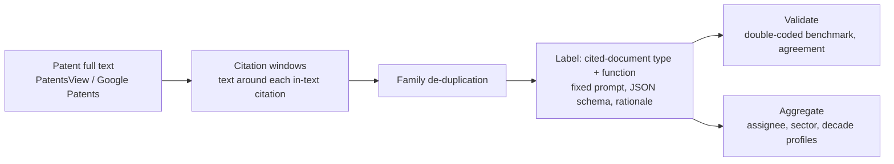

# Science in Invention

**How is science used in invention?**

When a patent cites a scientific paper in its description, what is the paper doing there? It may supply the
mechanism the invention rests on, a method the inventors adopted, a prior approach they distinguish, materials
they sourced, or just background. [Reliance on Science](https://zenodo.org/communities/relianceonscience)
(Marx and Fuegi) tells us *which* papers a patent cites. This project reads the sentence around each in-text
citation and labels *what the paper is used for*, then aggregates to firms, industries and decades so that the
purpose of citing science can be compared across industries and followed over time.

Pilot stage, October 2026. Everything here is real output of the pipeline: 109 patents from 68 firms across eight
sectors, plus a decade sample of nine firms from the 1980s to the 2010s, every citation window labeled with a
written rationale. Built as the working repository behind an NBER i3 Open Data Fellows 2027 proposal.

## What the pilots show


- **Industries use science for different things.** Pharma cites papers for the biology the invention rests on
  (foundation, 35%) and for disease context (background, 34%). Software/AI and chemicals cite papers for methods
  they adopt (50% each). Semiconductors cite papers mostly as prior art they improve on (38%). A citation count
  treats all of these alike.
- **The label set holds up on real text.** Every one of the 291 windows received exactly one primary function;
  the hard cases (one paper serving as materials source, mechanism and distinguished prior art in consecutive
  paragraphs of a Boston Scientific patent) are informative rather than ambiguous. Each label carries a
  one-sentence rationale, so every call can be checked.


- **Pharma's use of science changed over four decades.** In the 1980s, Pfizer, Lilly and Bristol-Myers cited
  papers mainly for methods: synthetic procedures, assays, cloning protocols (57% of science citations). By the
  2010s they cited papers for the target biology the drug rests on (foundation, 44%) and, in parallel, for
  standard antibody definitions copied across patents (boilerplate, 44%); methods fell to zero.
- **Chemicals stayed put.** Dow, Du Pont and Air Products cite papers mostly as prior art they distinguish
  (33% to 46% in every decade) and for methods (8% to 29%).
- **Electronics patents rarely cite papers in the text.** For IBM, General Electric and Texas Instruments,
  about 70% of the citation windows point to other patents; the 1990s cell has no paper citation at all. The
  document-type label makes this visible instead of counting it as science use.

Read these as a demonstration, not as estimates: the decade cells hold 5 to 18 science-citing windows from
2 to 6 patents, every label comes from one model run interactively, and no second coder has labeled anything yet
(see *Provenance and limits*).

## Four windows, four labels

| Sector, decade | What the patent says (abridged) | Label | Why |
| --- | --- | --- | --- |
| pharma, 1980s (Eli Lilly, US4775624A) | "...can be conventionally synthesized by the modified phosphotriester method ... in substantial accordance with the procedure of Itakura et al., 1977, Science 198: 1056" | method or tool | the cited procedure is the one used |
| pharma, 2010s (Bristol-Myers Squibb, US10273236B2) | "...propagated via the feedback activation of Factors V, VIII and XI by catalytic amounts of thrombin (Gailani et al., 2007). ... Therefore, factor XIa plays a key role ... and is thus an attractive target" | foundation | the cited mechanism is why the target is chosen |
| chemicals, 1980s (Dow, US4798081A) | "...while size exclusion chromatography provides insight into long chain branching (Lecacheux et al., 1982, 1984), size exclusion chromatography leaves much to be desired where short chain branching information is required" | prior art distinguished | the cited technique's limitation motivates the invention |
| pharma, 2010s (Pfizer, US10138298B2) | "(v) a dAb portion (Ward et al., (1989) Nature 341:544-546), which consists of a VH domain" | definitional boilerplate | a standard definition copied across antibody patents |

All 486 labeled windows, with their rationales, are in `pilot/citation_windows_labeled.jsonl` and
`pilot/decades/citation_windows_labeled.jsonl`; `examples/demo/report.md` shows 34 of them top to bottom.

## The pipeline



1. `fetch_patents.py`: description paragraphs and citation windows. For samples it reads Google Patents pages
   (`--assignee "Eli Lilly~Lilly" --after-priority 19800101 --before-publication 19891231`); for the full build it
   runs over PatentsView's bulk description text starting from the in-text citations in Reliance on Science, so every
   row inherits the patent-paper match and its confidence score. The cue finder is tuned for recall: it also catches
   "et al." in patent citations, which the next stage sorts out.
2. `common/llm.py --prompt prompts/label_citation_function.md --schema schema.json`: for each window, the cited-document
   type (paper, patent, standards document, book, software, mixed) and the function (foundation, method or tool, prior
   art distinguished, data or materials source, background, definitional boilerplate, incorporated reference list,
   own-family continuation), with a confidence and a one-sentence rationale. Works with the Anthropic API or any
   OpenAI-compatible endpoint (vLLM, Together, DeepInfra), so an open-weight model can run the production pass; results
   are cached by (model, prompt, schema, text).
3. `aggregate.py --by assignee|sector|year|decade|sector_decade`: shares by function with counts, after dropping family
   duplicates and windows that cite only patents.
4. `common/validate.py`: schema checks, and accuracy, Cohen's kappa and per-label precision/recall between any two label
   files (model vs. human benchmark, model vs. model).

`run_pipeline.py` chains the stages for a list of patents and writes a readable report; `examples/demo/` is one such
run on four patents (Purdue/Corteva, Moderna, NVIDIA, Boston Scientific) with every intermediate file kept.

## Data in this repository

| Sample | Patents | Firms | Windows | Science-citing, de-duplicated | Files |
| --- | --- | --- | --- | --- | --- |
| Pilot, eight sectors, priority 2017+ | 109 | 68 | 291 | 211 | `pilot/` |
| Decade sample, three sectors, 1980s to 2010s | 71 | 9 | 195 | 139 | `pilot/decades/` |
| Worked example | 4 | 4 | 34 | 32 | `examples/demo/` |

Each labeled row: patent, assignee, dates, window text, document type, function, confidence, verbatim citation
string, rationale, family-duplicate flag. Profiles (`profiles_*.csv`) give shares with window and patent counts.
`pilot/summary.md` and `pilot/decades/summary.md` hold the tables behind the figures.

## Reproduce

```text
pip install -r requirements.txt
bash scripts/rebuild_pilot.sh      # labeled files, summaries, profiles, figures, schema checks; no API needed

# a new sample from Google Patents, then labels from a model
python fetch_patents.py --source google --assignee "Genentech" --after-priority 20170101 --max-windows 3 --output new.jsonl
python common/llm.py --prompt prompts/label_citation_function.md --schema schema.json --input new.jsonl --output new_labeled.jsonl

# agreement between two label files (e.g. an open-weight model vs. the pilot labels)
bash benchmark/run_benchmark.sh https://api.together.xyz/v1 Qwen/Qwen3.6-32B-Instruct
python common/validate.py agreement --a pilot/citation_windows_labeled.jsonl --b benchmark/labels_qwen.jsonl --id window_id --field function
```

## Provenance and limits

- **Labels.** All labels in this repository were produced by one closed model (claude-fable-5-1) in an interactive
  session with the prompt in `prompts/`; `pilot/labels_pilot.py` and `pilot/decades/labels_decades.py` hold every label
  with its rationale and regenerate the labeled files. No second coder and no second model has labeled anything yet.
  Double coding and the open-weight comparison (`benchmark/`) are the first tasks of the fellowship year.
- **Sampling.** Pilot patents are the first granted patents per assignee query in Google's ranking that contain
  "et al." (priority 2017+, up to three windows each); the decade sample takes the first two per firm and decade with
  priority and grant in the decade. Google's assignee search is fuzzy; the decade sample filters on the printed
  assignee, the first pilot kept corporate fuzzy matches under the printed name (`pilot/README_pilot_method.md`).
- **Windows.** The regex cue finder accepts noise by design; in the full build the window finder starts from the
  Reliance on Science in-text citations, and a lightweight classifier replaces the regex.
- **Cell sizes.** Sector and decade cells are small (counts are printed next to every share); the figures show that
  the measure separates industries and moves over time, not how much.

## Repository layout

```text
README.md                   this file
figures/                    function_by_sector.png, function_by_decade.png (from scripts/make_figures.py)
schema.json                 JSON schema for one labeled window
prompts/                    the labeling prompt
fetch_patents.py            collection stage (Google Patents samples; PatentsView bulk text)
run_pipeline.py             end-to-end: fetch -> window -> label -> aggregate -> report
aggregate.py                science-use profiles by assignee, sector, year, decade
common/llm.py               schema-constrained labeling, provider-agnostic, cached
common/validate.py          agreement metrics and schema checks
benchmark/                  model comparison: run_benchmark.sh, results.md (empty until run)
examples/demo/              worked example: four patents, every intermediate file, report.md
pilot/                      291-window pilot: raw and labeled windows, labels_pilot.py, profiles, summary.md
pilot/decades/              decade sample: raw and labeled windows, labels_decades.py, profiles, summary.md
scripts/rebuild_pilot.sh    regenerates every derived file and figure, runs the schema checks
scripts/make_figures.py     the two README figures from the profiles
docs/firm_linkage.md        joins to PatentsView, DISCERN, KPSS and the 1900-1980 Golden Age firm panel
```

## Roadmap

- [x] Pilot: 109 patents, 291 windows labeled with rationales; sector profiles (Oct 26-30, 2026)
- [x] Decade sample: nine firms, three sectors, 1980s-2010s; sector-by-decade profiles (Oct 31, 2026)
- [ ] Double-code the pilots; open-weight model comparison (`benchmark/`)
- [ ] 2,000-window benchmark stratified by sector, citation format and decade; two coders, adjudication, codebook
- [ ] Document-type and function passes over every Reliance on Science in-text citation in US patents, 1976-2024
- [ ] Firm linkage (DISCERN, KPSS, Golden Age panel); industry-year and firm-year science-use profiles
- [ ] v1.0 release (code on GitHub, data on Zenodo and the i3 Index) with codebook, December 2027

## Sources and terms

USPTO full text via PatentsView (public domain); Google Patents (terms of use; samples only); Reliance on Science
(Marx and Fuegi; cite it when using the patent-paper links); OpenAlex (CC0); DISCERN and KPSS under their own
licenses for the firm crosswalks. Code: MIT (`LICENSE`). Released data: CC BY 4.0. Citation: `CITATION.cff`.

Contact: Hansen Zhang, Duke University (Fuqua), hansen.zhang@duke.edu.
